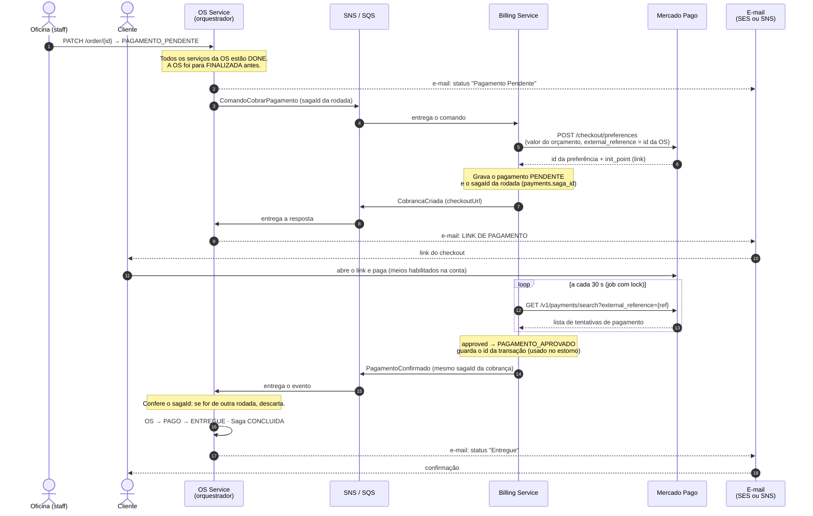
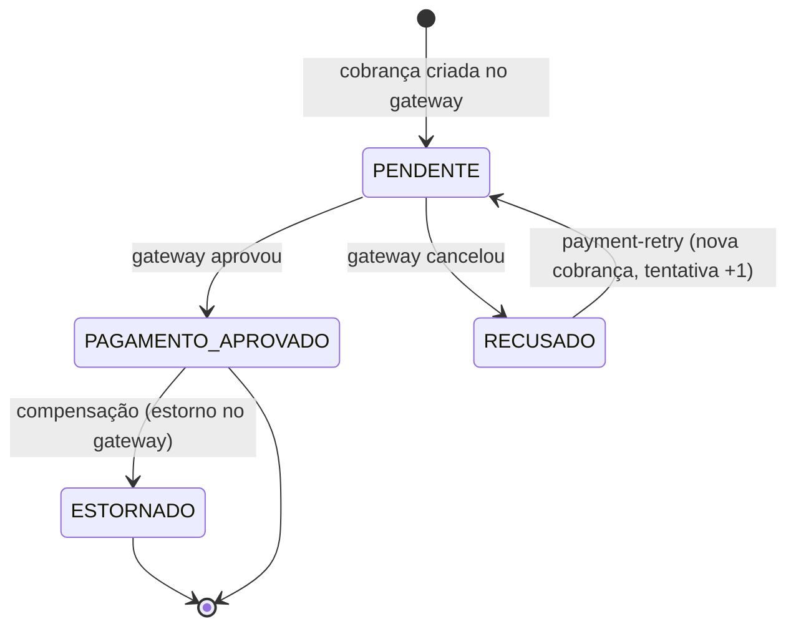

# workbench-billing-service — Billing Service

Microsserviço de **orçamento e pagamento** da plataforma Workbench (Tech Challenge —
FIAP Pós Tech, Fase 4). Gera o orçamento da OS e processa o pagamento via
**Mercado Pago**, com histórico append-only.

> **Contexto (Fase 4):** na Fase 3 a oficina era um **monólito** (`workbench-monolith`,
> mantido como base histórica). Na Fase 4 a aplicação foi refatorada em
> **microsserviços independentes**, cada um com seu repositório, infraestrutura e
> banco próprios. Este repositório é o **Billing Service**. A divisão dos serviços e a
> estratégia da Saga estão nos ADRs (`workbench-monolith/docs/adr` — ADR-0006 e ADR-0005).

---

## Sumário

- [Responsabilidades](#responsabilidades)
- [Requisitos obrigatórios do PDF cobertos aqui](#requisitos-obrigatórios-do-pdf-cobertos-aqui)
- [Fluxo de pagamento](#fluxo-de-pagamento)
- [Integração Mercado Pago (via porta)](#integração-mercado-pago-via-porta)
- [Participação na Saga](#participação-na-saga)
- [Arquitetura da aplicação (hexagonal)](#arquitetura-da-aplicação-hexagonal)
- [Arquitetura de infraestrutura](#arquitetura-de-infraestrutura)
- [Fluxo de Deploy (CI/CD)](#fluxo-de-deploy-cicd)
- [Tecnologias](#tecnologias)
- [Como executar localmente](#como-executar-localmente)
- [Deploy em Kubernetes / AWS](#deploy-em-kubernetes--aws)
- [Referência de endpoints](#referência-de-endpoints)
- [Testes e cobertura](#testes-e-cobertura)
- [Documentação da API (Swagger)](#documentação-da-api-swagger)

---

## Responsabilidades

- **Orçamento**: montado a partir dos itens recebidos no `ComandoGerarOrcamento` —
  **peças** (precificadas pelo Execution, com marca) + **mão de obra** por serviço
  (item `SERVICE_COST`, vinda do OS Service). Congela um snapshot de preço; expõe
  total de peças, total de MO e total geral.
- **Pagamento**: ocorre **no fim do fluxo** (ADR-0005). Máquina de estados
  `PENDENTE → PAGAMENTO_APROVADO | RECUSADO`, `RECUSADO → PENDENTE` (nova cobrança) e
  `PAGAMENTO_APROVADO → ESTORNADO` (estorno no Mercado Pago; ainda sem gatilho no os-service).
- **Histórico de pagamento** (append-only) para auditoria e verificação.

---

## Requisitos obrigatórios do PDF cobertos aqui

| Requisito (PDF Fase 4) | Como este serviço atende |
|---|---|
| ≥3 microsserviços independentes | É um dos 4 serviços, com repo/infra/banco próprios |
| Banco próprio | **PostgreSQL** exclusivo; nenhum outro serviço o acessa |
| SQL **e** NoSQL (no conjunto) | Contribui com o **SQL** (PostgreSQL) |
| Nenhum acesso ao banco de outro serviço | Recebe os itens já precificados por mensagem; **não** acessa estoque/OS |
| REST + mensageria assíncrona | API REST (orçamento/pagamento) + **SNS/SQS** (comandos/eventos) |
| **Pagamento Mercado Pago** | `PaymentGatewayPort` com adapter Mercado Pago (Checkout Pro, sandbox/produção) + job que consulta o pagamento |
| Saga Pattern + compensação | Participa da Saga; publica `OrcamentoFalhou` para retry/compensação; estorno via `ComandoEstornarPagamento` (implementado aqui; o os-service ainda não envia o comando) |
| Testes + 80% cobertura + Sonar | JaCoCo gate 80% no `verify` + SonarCloud (cobertura ~86%) |
| CI/CD + deploy K8s + branch protegida | Pipeline próprio; `main` protegida |

---

## Fluxo de pagamento

Esta seção explica **como o pagamento acontece, quando acontece e quem faz o quê**: da OS
finalizada até o cliente pagar, incluindo o que o cliente recebe por e-mail em cada etapa. Os
três serviços participam: o **OS Service** orquestra, o **Billing** cobra e consulta o gateway,
e o **Mercado Pago** recebe o dinheiro. Nenhum serviço fala direto com outro: tudo passa por
mensagens (SNS/SQS) da Saga.

### Visão geral



### Quando cada coisa acontece

| Momento | Gatilho | O que ocorre |
|---|---|---|
| **A cobrança é criada** | A OS entra em `PAGAMENTO_PENDENTE` (staff, via `PATCH /order/{id}`) | O OS Service envia `ComandoCobrarPagamento`; o Billing cria a preferência no Mercado Pago e responde `CobrancaCriada` com o link. Ninguém chama a API de pagamento à mão |
| **O cliente recebe o link** | Resposta `CobrancaCriada` chega ao OS Service | E-mail com o link (e o `checkoutUrl` também fica em `GET /api/payments/service-order/{id}`) |
| **O pagamento é detectado** | Job do Billing, **a cada 30 s** | Consulta o Mercado Pago pela `external_reference`; achando um pagamento `approved`, confirma |
| **A OS é entregue** | Evento `PagamentoConfirmado` aceito | A OS vai a `PAGO` e `ENTREGUE` na mesma transação; a Saga fecha em `CONCLUIDA` |
| **O pagamento é recusado** | Mercado Pago devolve a tentativa como `cancelled` | Billing marca `RECUSADO` e publica `PagamentoFalhou`; a OS **fica em `PAGAMENTO_PENDENTE`** com o motivo na Saga |
| **Nova cobrança** | `POST /order/{id}/payment-retry` (cliente dono ou staff) | Gera uma cobrança **nova** (referência `<OS>-2`, `<OS>-3`…) e um novo link |

Quem **detecta** o pagamento é o Billing, por consulta. O Mercado Pago **não** avisa o sistema (não há
webhook público): é o Billing que pergunta. Isso evita expor um endpoint de pagamento na internet
e dispensa URL pública para o Mercado Pago chamar.

### Estados do pagamento



| Estado | Significa | O que o histórico registra |
|---|---|---|
| `PENDENTE` | Cobrança criada, esperando o cliente pagar | "Cobrança criada no gateway: `<id>`" |
| `PAGAMENTO_APROVADO` | O Mercado Pago aprovou; o id da transação foi guardado | "Consulta ao gateway: aprovado" |
| `RECUSADO` | A tentativa foi cancelada no Mercado Pago | "Consulta ao gateway: recusado" |
| `ESTORNADO` | O dinheiro foi devolvido (compensação) | "Estorno (compensação da Saga)" |

No Checkout Pro o cliente pode errar o cartão e tentar de novo **no mesmo link**. Por isso uma tentativa
`rejected` **não** encerra a cobrança: só um `approved` (em qualquer tentativa) aprova, e só um
`cancelled` na tentativa mais recente recusa. O resto continua `PENDENTE`.

### E-mails do cliente durante o pagamento

O OS Service envia o e-mail **depois do commit** do banco (`AfterCommit`), então o cliente nunca é
avisado de algo que não foi gravado. A falha de envio nunca reverte a OS (best-effort).

| Momento | E-mail | Observação |
|---|---|---|
| OS vai a `PAGAMENTO_PENDENTE` | Status "Pagamento Pendente": *aguardando a confirmação do pagamento* | Sai pela atualização de status |
| Cobrança criada | **Link de pagamento** (assunto "Link de Pagamento da sua Ordem de Servico") | Só o link em texto; **não há QR code** |
| Pagamento confirmado | Status **"Entregue"**: *seu veículo foi entregue* | **Um** e-mail: a OS passa por `PAGO` e `ENTREGUE` na mesma transação |
| Pagamento recusado | Aviso **"pagamento não aprovado"** | A OS não muda de status, então este e-mail é o único aviso. Sai **uma vez** por recusa (entrega duplicada do SQS não repete) e **não traz o motivo técnico** do gateway nem link; pede novo link à oficina. Uma recusa depois de `payment-retry` avisa de novo |
| `payment-retry` | **Novo link** de pagamento | A cobrança nova tem outro link |

Os e-mails de status (`Recebida`, `Em Diagnostico`, `Em Execucao`, `Finalizada`…) saem a cada mudança de
status feita pela API. As transições feitas **pela Saga** (aprovação do orçamento, por exemplo) não
notificam. Isso é uma limitação conhecida.

**Para quem o e-mail vai** depende do canal (`NOTIFICATION_CHANNEL` no OS Service):

| Canal | Destinatário |
|---|---|
| `sns` (padrão) | Quem estiver **inscrito no tópico** (um endereço fixo): serve para demonstração, **não chega ao cliente** |
| `ses` | O **e-mail cadastrado do cliente** no Customer Service. Cliente sem e-mail não recebe (fica no log). Conta SES nova está em *sandbox*: só envia para endereços verificados |

Detalhes e como ligar o SES: README do OS Service, seção *E-mail ao cliente: SNS × SES*.

### Por que a Saga confia no `sagaId`

O OS Service só aceita uma resposta com o `sagaId` da **rodada atual** da Saga (uma OS que falha e é
diagnosticada de novo abre uma rodada nova). `PagamentoConfirmado` **não responde a um comando**: ele sai
do job de consulta, depois de minutos. Por isso o Billing guarda o `sagaId` do `ComandoCobrarPagamento`
na cobrança (`payments.saga_id`, migration V9) e o usa ao publicar o resultado. Sem isso, o evento era
descartado como "de outra rodada" e a OS ficava eternamente em `PAGAMENTO_PENDENTE`.

### Quando algo dá errado

| Situação | O que acontece |
|---|---|
| Mercado Pago fora do ar ao criar a cobrança | O comando falha e volta para a fila. Após **3 tentativas** vai para a **DLQ** (alarme no CloudWatch). O OS Service também **reenvia** um comando sem resposta após 60 s |
| Mercado Pago fora do ar na consulta | O job registra o aviso e tenta o **próximo ciclo** (30 s). Os demais pagamentos não são afetados |
| Duas réplicas do Billing | O job usa **ShedLock**: roda em uma só. A criação da cobrança trava a linha do orçamento (`SELECT … FOR UPDATE`): não cobra duas vezes |
| Comando de cobrança repetido (SQS entrega "pelo menos uma vez") | Idempotente: devolve a cobrança existente sem chamar o gateway |
| `PagamentoConfirmado` chega fora de hora (Saga fora de `AGUARDANDO_PAGAMENTO`, ou de outra rodada) | O OS Service **descarta** o evento e registra um aviso no log. O que o Billing faz com um pagamento aprovado cuja OS já não aguarda pagamento **não foi testado** |
| Estorno (compensação) | O Billing sabe estornar (`ComandoEstornarPagamento`, id da transação no Mercado Pago), mas **o OS Service ainda não envia esse comando** em nenhum fluxo: está implementado só deste lado |

### Como testar sem o Mercado Pago

Com `PAYMENT_PROVIDER=fake` (padrão no perfil `local`) o gateway é simulado e existe um webhook **só
para desenvolvimento**, que faz o papel do cliente pagando:

```bash
# 1) leve uma OS até PAGAMENTO_PENDENTE (Saga Ponta a Ponta); a cobrança sai sozinha
GPID=$(curl -s -H "Authorization: Bearer $STAFF" $G/api/payments/service-order/$OS | jq -r .gatewayPaymentId)
# 2) simule o pagamento: aprovado ou recusado (sem token)
curl -X POST $G/api/payments/webhook -H 'Content-Type: application/json' \
  -d "{\"gatewayPaymentId\":\"$GPID\",\"approved\":true}"
```

Com `PAYMENT_PROVIDER=mercadopago` esse webhook **não existe** (responde 404) e o pagamento só é
detectado pelo job. Como o webhook simulado não verifica assinatura, o `FakeProviderGuard` **impede o
serviço de subir** com `fake` fora do perfil `local` (ou de `payment.allow-fake=true`, usado só nos
testes): um `PAYMENT_PROVIDER=fake` configurado por engano na AWS derruba o start em vez de abrir a rota. Para testar de verdade, use o token de **teste** do Mercado Pago, abra o `checkoutUrl`
em janela anônima, entre com o usuário **comprador** de teste e pague com um cartão de teste (titular
`APRO` para aprovado).

## Integração Mercado Pago (via porta)

`PaymentGatewayPort` com adapters intercambiáveis (`payment.provider`):

| provider | adapter | uso |
|---|---|---|
| `fake` (default) | `FakePaymentGatewayAdapter` | ambiente local e testes, offline |
| `mercadopago` | `MercadoPagoGatewayAdapter` | AWS: sandbox (homologação) / produção |

**Como o pagamento é confirmado:**

- **`mercadopago` (AWS):** a cobrança é uma preferência do Checkout Pro
  (`POST /checkout/preferences`). A `external_reference` é a **referência da cobrança**:
  o id da OS na 1ª tentativa e `<OS>-2`, `<OS>-3`… nas novas cobranças após recusa, para a
  consulta não confundir a tentativa nova com a cancelada. O job
  `PaymentStatusPollingJob` roda a cada `PAYMENT_POLLING_INTERVAL_MS` (30 s) e, para
  cada pagamento `PENDENTE`, consulta `GET /v1/payments/search?external_reference={ref}`:
  qualquer tentativa `approved` → aprova; tentativa mais recente `cancelled` → recusa;
  o resto (`pending`, `in_process`, `rejected` com nova tentativa possível) → espera. A
  decisão publica `PagamentoConfirmado`/`PagamentoFalhou` para a Saga e grava o **id do
  pagamento aprovado** no provedor (usado no estorno). ShedLock garante uma réplica por
  vez. **Não há webhook público.**
- **Estorno:** `POST /v1/payments/{id}/refunds` com `X-Idempotency-Key` (estorno repetido
  não devolve duas vezes). Pagamento aprovado pelo webhook simulado não tem transação no
  provedor e não chama o gateway.
- **`fake` (local):** a decisão vem do **webhook simulado** `POST /api/payments/webhook`
  (`{"gatewayPaymentId": "...", "approved": true}`), que só existe com esse provider.

Trocar sandbox→produção é apenas `MP_ACCESS_TOKEN` (credencial de teste → credencial de produção; **ambas** começam com `APP_USR-`) — **sem
mudança de código**.

---

## Participação na Saga

| Recebe (comando) | Faz | Publica (evento) |
|---|---|---|
| `ComandoGerarOrcamento` | gera orçamento (peças + MO) | `OrcamentoGerado` ou `OrcamentoFalhou` (motivo) |
| `ComandoCobrarPagamento` | cria cobrança no gateway; se o pagamento anterior foi **recusado**, cria uma **nova** cobrança (novo link) | `CobrancaCriada` (confirmação depois, pelo job de consulta) |
| `ComandoEstornarPagamento` | estorna no Mercado Pago e marca ESTORNADO | `PagamentoEstornado` |

`OrcamentoFalhou` permite ao orquestrador (OS Service) fazer **retry** e, esgotado,
**compensar** liberando a reserva de estoque (ver ADR-0005). Payload malformado também
responde `OrcamentoFalhou` (não vai para a DLQ sem resposta).

Comandos repetidos (reenvio por timeout ou SQS) não duplicam efeito: cobrança existente é
devolvida sem chamar o gateway; aprovação/recusa repetida é ignorada. Duas réplicas com o
mesmo comando não cobram duas vezes (a linha do orçamento é travada durante a criação).

**Rodada da Saga no pagamento:** `PagamentoConfirmado`/`PagamentoFalhou` não respondem a um
comando (saem do job de consulta ou do webhook simulado). Por isso a cobrança guarda o
`sagaId` recebido no `ComandoCobrarPagamento` (coluna `payments.saga_id`, migration V9) e o
resultado é publicado com ele — o orquestrador descarta evento de outra rodada (ADR-0008).
Cobrança sem rodada (antiga ou criada por `POST /api/payments/service-order/{id}`) usa o id
da OS. Consumer com dedupe
por `messageId` e redrive para **DLQ**. Nomes e campos seguem o contrato executável
`workbench-messaging/contracts/saga-messages.json` (`BillingSagaContractTest`).

---

## Por que este banco

**PostgreSQL**, porque é dinheiro: orçamento, itens, pagamento e histórico precisam de transação ACID, `NUMERIC` exato e unicidade (um pagamento por OS). A criação da cobrança trava a linha do orçamento (`SELECT ... FOR UPDATE`) para duas réplicas não cobrarem duas vezes.

As demais decisões (MongoDB no execution, Saga orquestrada, SNS/SQS, EKS, Lambda…) estão respondidas uma a uma em `workbench-technical-documentation/01 - Arquitetura/Decisoes de Arquitetura.md`, com links para as ADRs.

---

## Arquitetura da aplicação (hexagonal)

```
src/main/java/com/workbench/workshop/
├── adapter/
│   ├── in/web/            # BudgetController, PaymentController, FakePaymentWebhookController (só fake) + *Dtos
│   └── out/persistence/   # Adapters JPA (budget, payment, histórico)
├── application/           # Uma classe por caso de uso + ports
│   ├── budget/            # GenerateBudget, FindBudget
│   └── payment/           # CreatePayment, HandlePaymentNotification, ListPendingPayments,
│                          # ReconcilePayment, FindPaymentByServiceOrder, FindPaymentHistory, RefundPayment
├── domain/                # Budget (totais derivados dos itens), BudgetItem (PART/SUPPLY/SERVICE_COST), Payment (máquina de estados)
└── infrastructure/        # config, persistence (JPA), messaging (SNS/SQS), payment (fake/mercadopago), scheduling (job + ShedLock)
```

---

## Arquitetura de infraestrutura

Banco **PostgreSQL próprio**, namespace `billing-service` no cluster EKS compartilhado
`workbench-platform-<env>` (provisionado pelo `workbench-k8s-terraform`). Sem acesso
cruzado a bancos; integra com os demais por REST/mensageria. Tópicos/filas no repo
`workbench-messaging`.

---

## Fluxo de Deploy (CI/CD)

```
push (main/develop) ou PR
   │
   ▼
unit-test ──▶ code-analysis ──▶ build ──▶ docker-build-push ──▶ deploy-aws
(mvn verify   (JaCoCo gate 80%  (mvn      (imagem p/ Docker Hub  (EKS, só se
 + JaCoCo      + Sonar)          package)  usuario/billing-service) USE_AWS=true)
 badge)
```

Secrets/variáveis comuns aos serviços (`DOCKER_*`, `SONAR_TOKEN`, `AWS_*`, `USE_AWS`) —
ver o README do `workbench-os-service`. Próprios deste serviço: `DB_URL_BILLING_<ENV>`,
`DB_USERNAME_BILLING`, `DB_PASSWORD_BILLING`, `JWT_SECRET` e **`MP_ACCESS_TOKEN`
(obrigatório)** — o deploy usa `PAYMENT_PROVIDER=mercadopago` (`k8s/configmap.yaml`), com
o Access Token de teste (`APP_USR-…`) do Mercado Pago. O job `deploy-aws` monta o Secret do
pod a partir deles (o `k8s/secret.yaml` só tem placeholders) e falha no início se faltar algum.

---

## Tecnologias

| Tecnologia | Finalidade |
|---|---|
| Java 21 + Spring Boot 4.0.9 | Framework web e DI |
| PostgreSQL 16 + Flyway | Banco próprio (SQL) + migrations |
| AWS SNS/SQS (SDK v2) | Mensageria da Saga + DLQ |
| Mercado Pago (REST) | Gateway de pagamento (via porta) |
| Micrometer + Datadog | Métricas e observabilidade |
| SpringDoc OpenAPI | Swagger UI |
| JaCoCo (gate 80%) + SonarCloud | Qualidade e cobertura |
| Testcontainers | Integração com PostgreSQL real |

---

## Como executar localmente

```bash
./mvnw spring-boot:run -Dspring-boot.run.profiles=local
```

> **Sem valores padrão para segredos.** Fora do perfil `local` (`JWT_SECRET`, a senha do banco e `PAYMENT_PROVIDER`) são
> obrigatórios: sem eles o serviço não sobe. O perfil `local` (`application-local.yml`)
> traz os valores de desenvolvimento e é ativado pelo compose do `workbench-messaging`.

| Variável | Default | Descrição |
|---|---|---|
| `SPRING_DATASOURCE_URL` / `_USERNAME` | Postgres local | Banco próprio do Billing |
| `SPRING_DATASOURCE_PASSWORD` | — (obrigatório; dev no perfil `local`) | Senha do banco |
| `JWT_SECRET` | — (obrigatório; dev no perfil `local`) | Segredo HS256 compartilhado |
| `PAYMENT_PROVIDER` | — (obrigatório; `fake` no perfil `local`) | `fake` (webhook simulado, sem assinatura — só local/testes) ou `mercadopago` (AWS, job de consulta). Sem valor, o serviço não sobe, e `fake` fora do perfil `local` também não sobe (`FakeProviderGuard`): o webhook aberto nunca aparece por omissão nem por engano |
| `MP_ACCESS_TOKEN` / `MP_BASE_URL` | — | credenciais do Mercado Pago (quando `mercadopago`) |
| `MP_NOTIFICATION_URL` | — | (opcional) URL de notificação enviada na preferência; a confirmação não depende dela |
| `PAYMENT_POLLING_INTERVAL_MS` | `30000` | intervalo do job de consulta ao Mercado Pago |
| `MP_CONNECT_TIMEOUT` / `MP_READ_TIMEOUT` | `5s` / `10s` | Timeouts das chamadas ao Mercado Pago (um gateway travado não congela a confirmação dos pagamentos) |
| `SCHEDULING_POOL_SIZE` | `4` | Threads dos jobs `@Scheduled` (consumidor SQS e consulta ao Mercado Pago não dividem uma thread só) |
| `MESSAGING_ENABLED` | `false` | liga SNS/SQS; `false` roda sem broker |
| `AWS_ENDPOINT` | — | vazio = AWS real; `http://localhost:4566` = LocalStack |
| `BILLING_COMMANDS_QUEUE_URL` | — | Fila de comandos da Saga para o Billing |
| `BILLING_EVENTS_TOPIC_ARN` | — | Tópico onde o Billing publica as respostas |

---

## Deploy em Kubernetes / AWS

Manifests em `k8s/` (`namespace`, `configmap`, `secret`, `app`, `hpa`). Deploy
automatizado pelo pipeline (`deploy-aws`, quando `USE_AWS=true`) no cluster
`workbench-platform-<branch>`, namespace `billing-service`.

O que os manifests garantem:
- **Rede:** o Service é um **NLB interno** (`aws-load-balancer-internal`), alcançável só de dentro da VPC. O tráfego de fora entra pelo API Gateway (VPC Link + authorizer JWT); Swagger e actuator não ficam na internet. Se o Service já existia como LB público, o pipeline o recria uma vez (o esquema de um LB não muda depois de criado). Uma `NetworkPolicy` deixa entrar só a porta 8080 (vale com NetworkPolicy ligada no VPC CNI).
- **Imagem:** o pipeline troca o `REPLACE_IMAGE` do `app.yaml` pela tag do commit antes do `kubectl apply` (um rollout por deploy). Não há tag `:latest`; o `dd-java-agent` injetado pelo Datadog tem versão fixa (`v1.68.2`).
- **Pods:** usuário não-root (UID 10001), sem escalar privilégio, sem capabilities, sistema de arquivos somente leitura (só `/tmp` gravável), `seccomp` padrão. A subida tem um `startupProbe` (até 5 min); liveness e readiness começam depois. A JVM usa até 75% da memória do container (`-XX:MaxRAMPercentage=75.0`).
- **Escala:** o número de réplicas é só do HPA (o `Deployment` não fixa `replicas`), e um `PodDisruptionBudget` tira no máximo 1 pod por vez numa troca de nó.
- **Banco:** o RDS do `workbench-database` (URL e credenciais no Secret). O Postgres in-cluster saiu do `app.yaml` e ficou em `k8s/postgres-local.yaml`, só para testar num cluster sem RDS (o pipeline não aplica e remove o que sobrou de deploys antigos).

---

## Segurança (JWT)

Defesa em profundidade: o serviço **valida o JWT por conta própria** (Spring Security +
filtro HS256 com o `JWT_SECRET` compartilhado), inclusive nas chamadas internas — não
depende do API Gateway. Tokens de staff carregam `roles` (ADMIN/TECHNICIAN); tokens de
cliente carregam `clientId` → `ROLE_CLIENT`.

Rotas **públicas** (sem token):
- `GET /actuator/health*`, Swagger/OpenAPI;
- `POST /api/payments/webhook` — webhook **simulado**, só existe com
  `PAYMENT_PROVIDER=fake` (local). Com `mercadopago` a rota não existe (404).

As consultas (`GET /api/budgets/**`, `GET /api/payments/**`) aceitam cliente
(`ROLE_CLIENT`) e staff; as demais rotas exigem ADMIN/TECHNICIAN. Com token de cliente, o
**dono é conferido no caso de uso**: o orçamento guarda o CPF/CNPJ do cliente
(`customerDocument`, enviado pelo OS Service no `ComandoGerarOrcamento`), e só o mesmo CPF
do token pode ler orçamento, pagamento e histórico — outro CPF recebe **403**. Orçamento
sem dono registrado (anterior a essa regra) só é visível ao staff.

### Boas práticas OWASP aplicadas
- **A01/A07 (acesso):** autorização por role em todas as rotas; ownership para cliente
  (orçamento/pagamento só do próprio CPF); JWT validado por serviço.
- **A03 (injeção/validação):** `@Valid` + Bean Validation nos DTOs de entrada; acesso a
  dados via Spring Data JPA parametrizado (sem concatenação de SQL).
- **A05 (misconfiguration):** headers `X-Frame-Options: DENY` e `X-Content-Type-Options:
  nosniff`; `k8s/secret.yaml` com **placeholders** (`REPLACE_ME`) — os valores reais vêm
  dos secrets da org, montados pela pipeline, nunca versionados; rota inexistente responde
  404 (não 500).
- **A09 (logs):** o CPF do cliente é mascarado no log (MDC) — nunca registrado por inteiro.

> Hotspot SonarCloud `java:S4502` (CSRF disabled) é marcado **Safe**: API REST stateless
> com JWT, sem cookie de sessão.

---

## Referência de endpoints

| Método | Rota | Descrição | Acesso |
|---|---|---|---|
| GET | `/api/budgets/service-order/{osId}` | Orçamento da OS (peças, MO e totais) | token |
| GET | `/api/payments/service-order/{osId}` | Pagamento da OS (status + **checkoutUrl**) | token |
| POST | `/api/payments/service-order/{osId}` | Criar cobrança (PENDENTE) — normalmente **automática** via Saga | staff |
| POST | `/api/payments/webhook` | Webhook simulado (aprova/recusa) — **só com `fake`/local** | público |
| GET | `/api/payments/service-order/{osId}/history` | Histórico de pagamento | token |

> **Link de pagamento (checkout):** ao criar a cobrança, o gateway devolve um
> `checkoutUrl`. Ele é **persistido** e enviado por e-mail (ao cliente com o canal SES; com o SNS, ao endereço inscrito no tópico; via os-service, no
> evento `CobrancaCriada`). Caso o cliente perca o e-mail, consulta o link em
> `GET /api/payments/service-order/{osId}` (campo `checkoutUrl`).

---

## Testes e cobertura

```bash
./mvnw verify
```

- **Gate JaCoCo 80%** no `verify`.
- Integração com **Testcontainers PostgreSQL**; gateway em modo `fake` (offline). Um 2º
  teste de integração sobe com `mercadopago` e garante que o webhook simulado **não existe**
  (404) e que o job de consulta está ativo. `FakeProviderGuardTest` garante que `fake` só sobe no
  perfil `local` (ou com `payment.allow-fake=true`).
- **Teste de contrato da Saga** (`BillingSagaContractTest`): consome o exemplo de
  `ComandoGerarOrcamento` do contrato e confere os campos de tudo o que publica.
- Cobertura atual (medida em 2026-11-15): **87,2% de linhas** e 73,4% de branches (`target/site/jacoco/index.html`).
- Evidência por execução do CI: artefato `jacoco-report` do job `unit-test` (relatório HTML) e o Quality Gate do SonarCloud no job `code-analysis`.

---

## Documentação da API (Swagger)

| Recurso | URL (local) |
|---|---|
| Swagger UI | http://localhost:8080/swagger-ui/index.html |
| OpenAPI JSON | http://localhost:8080/v3/api-docs |
